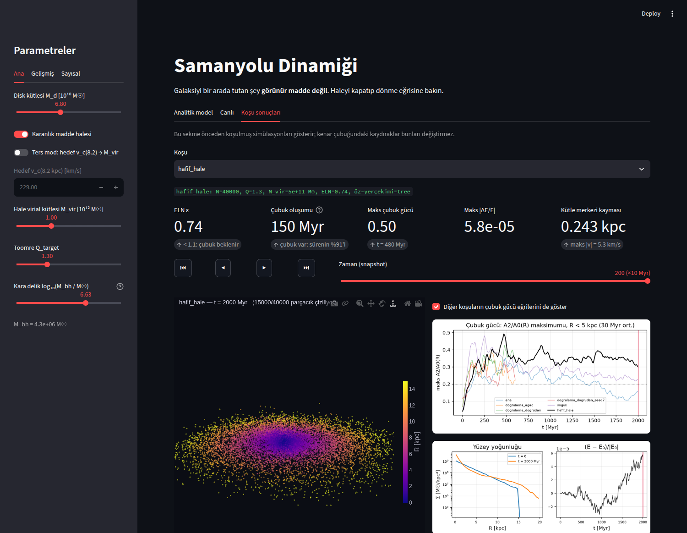
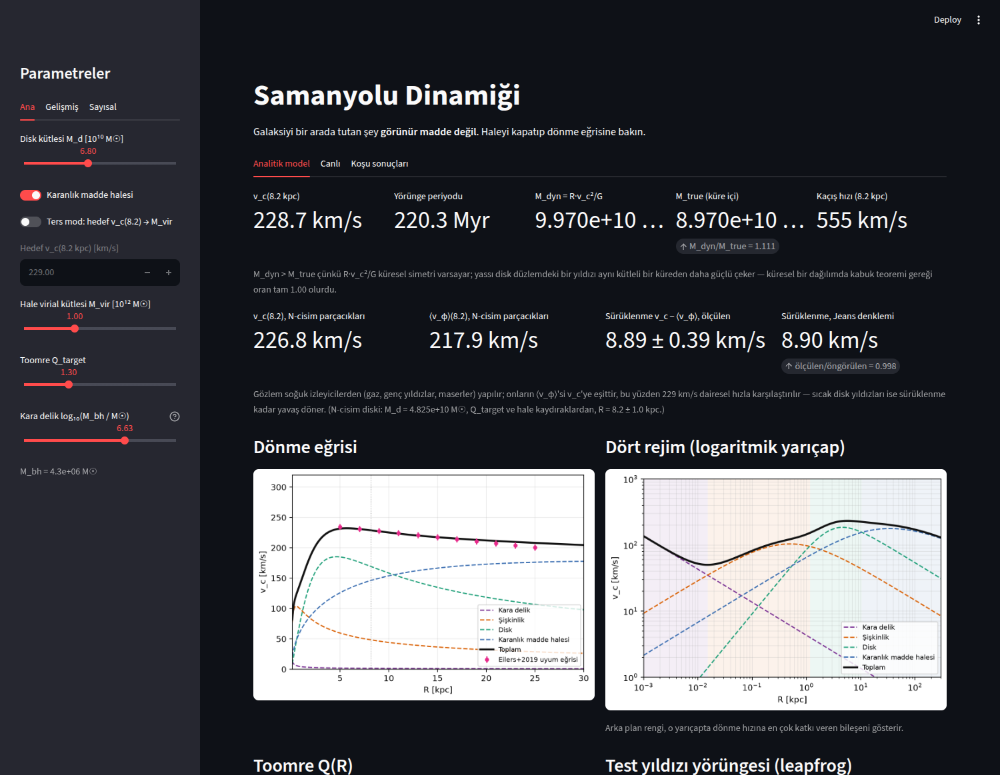

# Samanyolu Dinamiği

**Samanyolu'nun dönme eğrisini analitik bir modelle, çubuk ve sarmal kol oluşumunu 40 000 parçacıklı
bir N-cisim simülasyonuyla inceleyen ve galaksiyi bir arada tutanın görünür madde değil karanlık
madde olduğunu etkileşimli bir arayüzle gösteren bir hesaplamalı astrofizik projesi.**



**Canlı demo:** _bağlantı eklenecek_ (Streamlit Community Cloud, giriş dosyası `deploy/app.py`)

## Ana bulgular

**Dönme eğrisi gözlemle uyumlu.** Disk, şişkinlik, karanlık madde halesi ve merkezi kara delikten
oluşan modelde Güneş'in konumunda (8.2 kpc) dönme hızı **228.7 km/s**, yörünge periyodu **220 Myr**.
Eğri 5–20 kpc arasında 212–232 km/s bandında düz kalıyor. Model, Eilers ve ark. (2019) gözlemsel
uyum eğrisinden 5–19 kpc arasında en fazla 3 km/s sapıyor; daha dışarıda gözlemin üstüne çıkıyor
(25 kpc'de +7.7 km/s).

**Karanlık madde kapatılınca galaksi dağılıyor.** Hale kaldırıldığında 20 kpc'deki dönme hızı
212 km/s'den **123 km/s**'ye düşüyor (Kepler düşüşü). Yıldızlar mevcut hızlarıyla bağlı kalamıyor:
başlangıçta 8 kpc'nin dışında olan yıldızların medyan yarıçapı 500 Myr'de 10 kpc'den 47 kpc'ye çıkıyor.

**Hale hafifleyince çubuk daha erken, daha güçlü ve daha uzun oluşuyor.** Disk kütlesi aynı kalıp hale
kütlesi yarıya indirildiğinde:

| | Normal hale | Hafif hale (M_vir / 2) |
|---|---|---|
| Çubuk oluşumu | 390 Myr | **150 Myr** |
| En yüksek çubuk gücü (A2/A0) | 0.38 | **0.50** |
| Çubuk uzunluğu (medyan) | 3.5 kpc | **5.0 kpc** |
| Son 500 Myr'de çubuk var | %14 | **%100** |

**Hafif haleli çubuk gözlenen çubuklarla uyumlu.** Eşdönme yarıçapı / çubuk uzunluğu oranı
**ℛ = 1.11** (iki farklı uzunluk tanımıyla 1.11 ve 1.06). Gerçek gökadalardaki çubuklar 1.0–1.4
aralığında; bu çubuk "hızlı" sınıfında.

**Kararsız disk kendini düzenliyor.** Toomre Q = 0.8 ile başlatılan disk ilk 200 Myr'de topaklara
bölünüyor, sonra kendini ısıtıyor; Q 800 Myr'de 2.32'ye çıkıyor.

Yöntem, tüm tablolar ve açık sorular: [runs/SONUCLAR.md](runs/SONUCLAR.md).
Model ve kabul kriterleri: [PROJE_TANIMI.md](PROJE_TANIMI.md).



## Doğrulama

**54 otomatik test** (`tests/`), aralarında projenin dokuz kabul kriteri:

| Kriter | Beklenen | Ölçülen |
|---|---|---|
| v_c(8.2 kpc) | 229 ± 5 km/s | 228.7 km/s |
| Güneş'in yörünge periyodu | 220 ± 10 Myr | 220.3 Myr |
| Hale kapalı, v_c(20 kpc) | < 165 km/s | 122.8 km/s |
| Dinamik kütle M(<8.2 kpc) | 1.00e11 ± 0.05e11 M☉ | 9.97e10 M☉ |
| L_z korunumu | < 1e-6 | 1.3e-14 |
| Enerji, 1000 adım | < 1e-3 | 2.2e-6 |
| N-cisim diskinden v_c(8.2) | 229 ± 5 km/s | 227.1 km/s |

**Kuvvet hatası.** Barnes–Hut ağacı rastgele 500 parçacıkta doğrudan toplamla karşılaştırıldı.
Kuadrupol momentleri eklenince hata aynı θ'da 8–23 kat düştü; kullanılan ayar θ = 0.6.

| θ | Monopol RMS hata | Kuadrupol RMS hata |
|---|---|---|
| 0.4 | 0.43 % | 0.018 % |
| 0.5 | 0.70 % | 0.046 % |
| **0.6** | 1.01 % | **0.104 %** |
| 0.7 | 1.37 % | 0.166 % |

**Enerji korunumu.** Monopol ağaç enerjiyi tek yönde sürüklüyordu (600 Myr'de 4.0e-4). Kaynağı
öz-yerçekimi kapalı (1.8e-6) ve doğrudan toplamalı (3.5e-5) tanı koşularıyla ağaca indirildi.
Kuadrupolle 2000 Myr'lik üretim koşularında enerji sapması 3e-5 – 8e-5.

**Yakınsama çalışması.** θ, dt ve N ayrı ayrı değiştirildi; ölçek uzunluğu ve çubuk gücü dört ayarda
da gürültü içinde aynı çıktı. Disk kalınlığını yalnızca N değiştirdi; üretim koşuları bu nedenle
N = 40 000 ile yapıldı.

**Doğrudan toplamayla çapraz kontrol.** Ağaç ve doğrudan N² toplama aynı başlangıçtan koşturuldu.
Ölçek uzunluğundaki fark (0.065 kpc) ve çubuk gücündeki fark (0.037), yalnızca rastgele başlangıç
değişince oluşan farktan (0.211 kpc, 0.041) küçük.

## Bilinen sınırlar

- **Hale sabit potansiyel.** Çubuk, dinamik sürtünmeyle haleye açısal momentum aktaramıyor. Canlı
  haleli simülasyonlarda çubuklar daha güçlü ve uzun ömürlü oluyor.
- **Disk kalınlığı yakınsamadı.** Kalınlık 40 000 parçacıkta bile parçacık sayısına duyarlı; kalınlıkla
  ilgili sonuçlar 80 000 parçacıklı bir kontrol olmadan fiziksel sayılmamalı.
- **Açık soru:** Normal haleli modelde çubuğun 1300–1800 Myr arasındaki zayıflaması açıklanamadı.
  Bükülme, disk ısınması, desen hızı kaybı ve merkezi kütle birikmesi test edildi ve elendi.

## Çalıştırma

Python 3.12 ile denendi.

```bash
python3 -m venv .venv
.venv/bin/pip install -r requirements.txt

.venv/bin/python -m pytest tests                      # testler
.venv/bin/streamlit run deploy/app.py                 # arayüz, depodaki küçültülmüş veriyle
```

Arayüzde üç sekme var:

- **Analitik model:** kaydıraklarla dönme eğrisi, kütleler, Toomre Q, ters mod ve örnek bir yörünge.
- **Canlı:** test parçacıkları gerçek zamanlı ve 3B olarak dönüyor; kaydıraklar anında etkiliyor.
- **Koşu sonuçları:** N-cisim koşularının 3B görünümü, zaman kaydırağı, çubuk gücü ve enerji grafikleri.

Depodaki koşu verisi küçültülmüş bir kopyadır (`deploy/runs/`, ~9 MB: her 8. snapshot, 5000 parçacık).
Çubuk gücü ve enerji eğrileri tam çözünürlüklü koşudan gelir. Tam koşuları (~930 MB) yeniden üretmek için:

```bash
.venv/bin/python -m src.nbody --name ana --t_end 2000 --N 40000          # ~25 dk
.venv/bin/python -m src.nbody --name soguk --t_end 2000 --N 40000 --Q 0.8
.venv/bin/python -m src.analysis                                         # grafikler ve animasyonlar
.venv/bin/python deploy/make_deploy_data.py                              # küçültülmüş kopya
.venv/bin/streamlit run app.py                                           # tam veriyle arayüz
```

Hafif haleli koşu Python'dan başlatılır:
`src.nbody.run("hafif_hale", GalaxyParams(halo=HaloParams(M_vir=5e11)), num=NumericalParams(N=40000), t_end=2000)`.

## Dosya yapısı

```
app.py            Streamlit arayüzü
src/              fizik ve sayısal motor (birimler: kpc, Myr, M☉)
  potentials.py   analitik potansiyeller
  rotation.py     dönme eğrisi, kappa, Toomre Q
  orbits.py       leapfrog
  ics.py          N-cisim başlangıç koşulları
  nbody.py        Barnes–Hut ağacı (kuadrupol), N-cisim koşusu
  analysis.py     çubuk gücü, desen hızı, animasyon
  config.py       tüm varsayılan parametreler
ui/galaxy3d/      3B görünüm bileşeni
deploy/           bulut dağıtımı: küçültülmüş veri ve giriş noktası
tests/            otomatik testler
runs/             sonuç belgesi, seçili grafikler ve animasyonlar
docs/             ekran görüntüleri
```

## Araçlar

Python, NumPy, SciPy, Numba, Streamlit, Plotly, Matplotlib. Geliştirmede yapay zekâ destekli kodlama
aracı olarak Claude Code kullanıldı.

## Lisans

[MIT](LICENSE)
